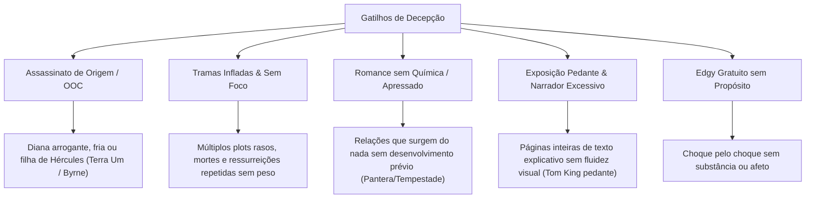

# 🧭 Diagnóstico do Perfil de Leitor: O DNA do Acervo

> [!abstract] Resumo Executivo
> **Arquétipo do Leitor:** *O Guardião do Heroísmo Mitológico & Humanismo Visceral*  
> Uma curadoria forjada em **402 edições lidas** e **122 obras favoritadas**. Você não consome quadrinhos e mangás apenas pelo espetáculo visual descartável: busca narrativas que equilibrem **densidade emocional, respeito à alma dos personagens, construção paciente de mundo e arte atmosférica**.

---

## 📊 Panorama Estatístico do Acervo

| Indicador | Volume | Percentual / Contexto |
| :--- | :--- | :--- |
| **Total de Obras Lidas** | **402** | Base consolidada no Acervo |
| **Favoritos Oficiais** | **122** | ~30% do acervo (critério exigente) |
| **Excelência (Notas 4.5 a 5.5)** | **154** | Obras que deixaram forte marca emocional |
| **Satisfatórias (Notas 3.5 a 4.0)** | **116** | Boas leituras de entretenimento consistente |
| **Zona Média / Neutra (Nota 3.0)** | **93** | Edições protocolares ou arcos de transição |
| **Obras Críticas / Frustrações (≤ 2.5)** | **36** | Casos claros de incompatibilidade temática ou editorial |

---

## 🏛️ Os 4 Pilares Fundamentais do Seu Gosto

### 1. Heroísmo Mitológico com Alma vs. Cinismo Vazio
> *"Chorei no nascimento da Diana, e todo o background das amazonas foi incrível... dá pra ver que estou lendo algo especial."* (Mulher-Maravilha por George Pérez)

* **O que te conquista:** Você tem uma veneração genuína pelo **heroísmo clássico que inspira**, personificado sobretudo pela Mulher-Maravilha (nas fases canônicas de George Pérez e Greg Rucka) e obras como *DC: A Nova Fronteira* de Darwyn Cooke. Você valoriza origens mitológicas autênticas (a criação a partir do barro, o lago das almas de Hipólita) e a crença inabalável na esperança e na compaixão.
* **O contraste:** Você rejeita veementemente quando autores tentam "desconstruir" esse heroísmo de forma cínica, transformando amazonas em ditadoras arrogantes (*Mulher-Maravilha: Terra Um*) ou heróis em assassinos desprovidos de peso moral (*Os Supremos Vol. 02*).

### 2. A Fantasia Sombria Visceral & Laços Inquebráveis
> *"Como pode não ter um volume ruim de Berserk... o momento que o Guts tá cercado por trevas e a luz entra no painel foi incrível em contraste a momentos horríveis acontecendo."* (Berserk)

* **O que te conquista:** Você é apaixonado por mundos implacáveis onde a escuridão é real, mas onde **a lealdade, a amizade e o afeto entre os personagens servem de farol** (*Berserk*, *Monstro do Pântano* de Alan Moore, *Undertaker* da Pipoca e Nanquim). A dor e o horror não existem por sadismo: servem para valorizar a vitória de cada respiração e a evolução de uma "party" que confia a vida uns aos outros (Guts & Schierke, Jonas & Rose).

### 3. Conexão Íntima, Cotidiano Sensível & "Slow Burn"
> *"Isso é bom demais, relação sendo construída devagar e ler ouvindo a música que as personagens escutam melhora muito a experiência... um dia a dia tão gostoso de ler."* (*O cara que estou a fim não é um cara*)

* **O que te conquista:** Em paralelo aos épicos de batalha, você possui uma sensibilidade aguçada para narrativas contemplativas e relacionamentos orgânicos. Obras como *O cara que estou a fim não é um cara*, *Planetes* (o caminho de Hachimaki descobrindo uma razão de amor para viver), *Frieren* e *Muito Além Daqui* funcionam com perfeição porque você valoriza as pausas, as sutilezas do diálogo e o impacto emocional construído camada por camada.

### 4. A Vanguarda Energética & Revitalização com Propósito
> *"Ver o passado dessa Diana e a relação com a Circe amei demais, que começo incrível."* (*Absolute Mulher-Maravilha*)  
> *"Vilão o Ogro um verdadeiro desgraçado... temi pela Rose."* (*Undertaker*)

* **O que te conquista:** A sua imensa adesão ao **Universo Absolute** (*Batman*, *Mulher-Maravilha*, *Lanterna Verde*, *Flash*) e ao **Universo Energon** (*Transformers*, *Rivais Cósmicos*, *Comandante Cobra*) demonstra que você ama quando uma franquia histórica ganha uma nova roupagem sem medo de arriscar, com arte dinâmica e vilões imponentes que não buscam desculpas fáceis para suas ações.

---

## 🚫 O Mapa de Dealbreakers (O que Gera Descontentamento)

Analisando as 36 obras com notas entre **0.5 e 2.5**, os motivos de nota baixa são surpreendentemente consistentes e revelam exatamente o que você rejeita:

> [!WARNING] Alertas Vermelhos para Futuras Compras
> 1. **Fase de John Byrne em Mulher-Maravilha:** Ficar longe de reimpressões similares desse período (cenários vazios, plots de "deus ex machina" constantes e coadjuvantes roubando a revista).
> 2. **Títulos 'Rushados' com Diálogo Escasso:** Obras que tentam cobrir grandes sagas em 4 ou 6 edições sem tempo para os personagens respirarem (ex: *Ultimate Pantera Negra*).
> 3. **Capas Enganosas:** Não comprar quadrinhos apenas pela capa chamativa sem antes verificar o tom interno e a receptividade do roteiro.

---

## 🎯 Bússola de Compras: O Teste dos 3 Filtros

Antes de entrar em uma nova assinatura ou comprar uma edição de valor elevado, submeta o título a esta lista de checagem:

- [ ] **Filtro de Personagem:** Os protagonistas possuem química real, vulnerabilidades autênticas e motivações claras, ou estão agindo como ferramentas de conveniência do roteirista?
- [ ] **Filtro de Arte & Fluidez:** A arte possui identidade marcante e cenários expressivos que ampliam a história (estilo Miura, Dragotta, Pérez, Giménez, Chabouté), ou se apoia em quadros genéricos?
- [ ] **Filtro de Tom Moral:** A história respeita o leitor com consequências e peso dramático, ou apela para violência inconsequente e mortes que serão desfeitas três edições depois?

---

## 🌟 5 Recomendações Cirúrgicas de Ouro

Com base no cruzamento das suas **obras favoritas**, aqui estão 5 indicações com altíssima probabilidade de nota 5:

### 1. ⚔️ *Vinland Saga* (Makoto Yukimura)
* **Por que você vai amar:** Você já declarou que *Planetes* (do mesmo autor) é uma das melhores coisas que já leu pela mensagem de humanismo e valor à vida, e você devorou os 35 volumes de *Berserk*. *Vinland Saga* une exatamente o combate histórico visceral de Miura com a jornada de redenção espiritual e humanista de Yukimura.

### 2. 🌌 *Far Sector: Setor Distante* (N.K. Jemisin & Jamal Campbell)
* **Por que você vai amar:** Em *Absolute Lanterna Verde*, você anotou explicitamente: *"Cara, amo a Jo, tô curtindo muito a história e o futuro é muito promissor"*. *Far Sector* é a obra-prima que apresentou Jo Mullein ao mundo: uma trama de investigação sci-fi noir densa, com uma das artes mais deslumbrantes da história recente dos quadrinhos da DC.

### 3. 🕊️ *A Menina do Outro Lado* (*Totsukuni no Shoujo* — Nagabe)
* **Por que você vai amar:** Conecta-se diretamente com o que te encantou em *Frieren*, *Uma Bruxa na Mongólia* e na relação de proteção mútua entre Guts, Schierke e Casca. Um conto de fadas sombrio onde a luz e a escuridão convivem, focado no carinho e no vínculo inabalável entre uma criança e uma criatura amaldiçoada.

### 4. 🦅 *Gideon Falls* (Jeff Lemire & Andrea Sorrentino)
* **Por que você vai amar:** Se você vibrou com o terror existencial e o mistério amarradinho de *Monstro do Pântano* e a atmosfera sombria de *Watchmen* e *Absolute Batman*, esta graphic novel entrega um mistério urbano e sobrenatural envolvente, com uma narrativa visual experimental e angustiante de altíssimo nível.

### 5. 🤠 *O Xerife da Babilônia* ou *Mister Miracle* (Tom King / Mitch Gerads)
* **Por que você vai amar:** Embora você tenha ressalvas com o estilo pedante de Tom King quando ele exagera na narração, você deu nota 5.0 para *Visão* (*"Virgínia foi a MVP, que cena"*). *Mister Miracle* opera nessa mesma chave de excelência: um mergulho psicológico comovente sobre família, depressão e heroísmo divino nos Novos Deuses, com arte magistral.
